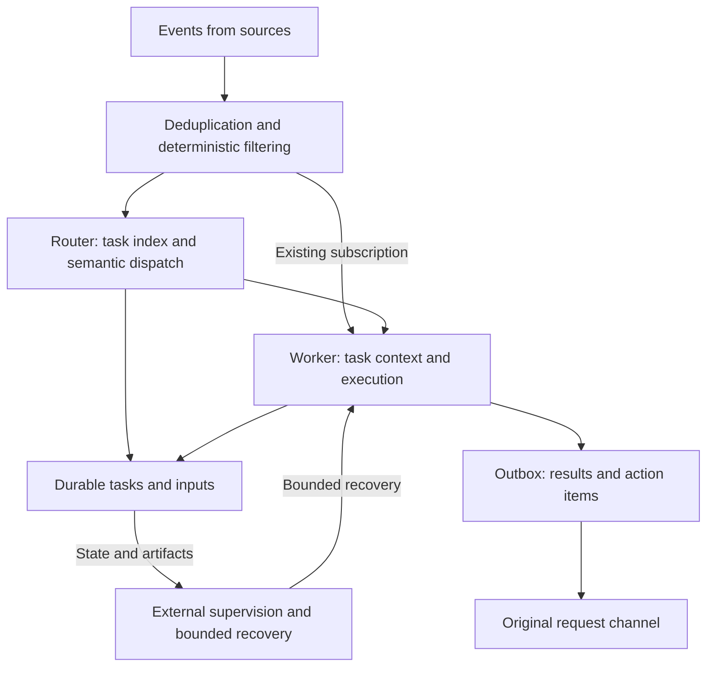

# From a Session Tool to a Persistent Collaborator

[简体中文](architecture.md) | English

Sources checked: **2026-11-01**. This guide follows the themes of the [official technical article](https://mp.weixin.qq.com/s/zoS7GlReWPhfCjENGxXCdg), cross-checked against the public prototype's domain, execution, and architecture materials. Engineering recommendations and the included lab are original teaching designs. Use the [prototype comparison](prototype-map.en.md) for evidence of actual public implementation.

## Learning objective and two-layer responsibilities

The bottleneck is human attention: as models do more, people still track progress, supply context, and find results across tasks. Coordination should take over task management so people focus on goals, decisions, and acceptance. Evaluate notifications, forms, and automation against that objective. [Official philosophy](https://github.com/deepseek-ai/dsh-superagent-prototype/blob/6337fc823ce20251c8de8085948165c81aaa701e/docs/000-philosophy.md)

This is a design sketch, not a complete call graph of the public prototype. The Router needs to know which task owns work and whether human action is needed. The Worker needs task materials, results, and next steps. Every tool log need not enter the Router's model context. [Official architecture](https://github.com/deepseek-ai/dsh-superagent-prototype/blob/6337fc823ce20251c8de8085948165c81aaa701e/docs/007-architecture.md)

## Five design themes as engineering decisions

| Theme | Problem | Decisions to make |
| --- | --- | --- |
| Two layers | Planning and execution compete for one session's context | Global index contents, task-context isolation, concurrency accounting |
| Event driven | Repeated human prompts and duplicate tasks from follow-ups | Stable event keys, subscriptions, new-work assessment, input ownership |
| Asynchronous multichannel interaction | Long commands block interaction; replies lose their destination | Durable input, backpressure, cancellation, per-task destination/delivery state |
| Separate state from compute | Worker/process loss destroys task facts | Durable fields, recovery boundaries, execution generations, external-effect deduplication |
| External Watchdog | Loops, stagnation, or infrastructure failure go unnoticed | Supervision evidence, liveness/progress assessment, retry budgets, stop/escalation conditions |

These are review questions, not configuration keys. Do not invent options such as `router.enabled` or `watchdog.autoFix` from this table.

## On-demand recall with finite context

The article's Inline & Spill and Chain of Recall treat the model window as a finite cache. Inline a limited amount of recent relevant material; keep large bodies outside the window and retrieve them through stable IDs and next-hop references. Preserve access to original evidence alongside summaries. Do not copy every task body into the Router for “global visibility.” The public prototype's bounded windows, stubs, expansion by ID, and pagination are concrete mechanisms, not unlimited memory. [Article](https://mp.weixin.qq.com/s/zoS7GlReWPhfCjENGxXCdg), [context assembly](https://github.com/deepseek-ai/dsh-superagent-prototype/blob/6337fc823ce20251c8de8085948165c81aaa701e/docs/007-architecture.md)

## Event routing and context

Record source and event with stable IDs. Route subscribed follow-up input before deciding on new work. A Thread need not contain only one task. Independent requests within one discussion require explainable ownership rather than whichever session happens to be active.

In the public prototype, Trigger is the idempotency unit, Ticket is authorized work, and Assignment binds a task to an execution. Subscription carries context; Correlation adds association evidence. Reuse these defined domain terms and constraints instead of inventing similar entities. [Domain model](https://github.com/deepseek-ai/dsh-superagent-prototype/blob/6337fc823ce20251c8de8085948165c81aaa701e/docs/001-domain.md)

Deterministic filtering handles source, reception scope, and identity rules. Semantic assessment decides whether there is work and which task owns it. Understanding a request does not grant execution scope. Follow-ups are input; expanding work still requires the corresponding authorization decision. [Authorization](https://github.com/deepseek-ai/dsh-superagent-prototype/blob/6337fc823ce20251c8de8085948165c81aaa701e/docs/002-authorization.md)

## Asynchrony is more than multiple subagents

Distinguish event ingress, Router, Worker, tool processes, and delivery. Each link needs its own queue/failure semantics. Backgrounding one long command does not prove every tool supports concurrency, cancellation, and immediate message insertion.

The article describes an asynchronous loop where a slow tool first returns a started status, then adds its result as a new session event; incoming messages are processed after the current reasoning step. It states this mechanism is implemented in Harness but not enabled by default. Check the target version's actual activation method; do not invent a universal switch. [Article](https://mp.weixin.qq.com/s/zoS7GlReWPhfCjENGxXCdg)

Define when running tasks consume new input, how messages arriving after completion resume or trigger reassessment, and how background work and slots behave during human handoff. Preserve the public prototype's specific execution semantics when modifying it. [Execution model](https://github.com/deepseek-ai/dsh-superagent-prototype/blob/6337fc823ce20251c8de8085948165c81aaa701e/docs/003-execution.md)

## Persistence, recovery, and delivery

Business tasks should outlive an execution instance. Persist tasks, inputs, current Assignments, and pending results. Decide intended side effects inside a transaction and execute them after commit. During recovery, identify processed input and the current generation so a stale Worker's late result cannot be treated as a new completion.

The Outbox supports recoverable sending attempts. Use stable message IDs when a platform supports idempotency keys. Otherwise acknowledge the duplicate window between external delivery and local receipt persistence. A database transaction does not include the remote platform; test that window. [Engine/Outbox boundary](https://github.com/deepseek-ai/dsh-superagent-prototype/blob/6337fc823ce20251c8de8085948165c81aaa701e/docs/007-architecture.md)

## Watchdog boundaries

Answer separately: is the process alive, is work progressing, does direction still match the goal, and is a human decision needed? Each requires different evidence; one health boolean cannot represent them all.

Supply goals, structured state, recent useful artifacts, errors, and last-activity times to supervision. Distinguish waiting on external conditions, long computation, and repeated failure before labeling stagnation. Bound automated recovery by attempts/time and stopping conditions. Reassignment retains the original scope. Model-based supervision can help, but using another model does not guarantee correct assessment.

These are design and acceptance recommendations. Check repository status/health/operations code capability by capability; a health page does not establish automatic semantic course correction.

## Verifiable failure scenarios

| Scenario | Expected observation |
| --- | --- |
| Same source event redelivered | No duplicate work; duplicate recorded or returned |
| Two tasks receive interleaved messages | Correct input ownership; A's private execution material does not automatically enter B |
| Subscription receives CI/follow-up input | Context reaches the corresponding task without creating work or expanding scope for every update |
| Follow-up during long work | Durable reception and continuation at the defined time; no lost input or false claim of immediate execution |
| Worker times out and is reassigned | Inputs remain; stale Assignment cannot overwrite the new result |
| Process restarts | Durable facts recover; no assumption that memory, terminal processes, and external effects recover together |
| Successful send loses its receipt | Duplicate window identified; platform idempotency or explicit duplicate semantics |
| Ordinary progress and a decision request coexist | Progress stays in records; decision reaches the appropriate person/channel |

Verify offline events and simulated senders first, then integrate real platforms within task scope. Report fault injection, business logic, and model-quality evaluation separately. One successful demo does not establish sustained operation.
