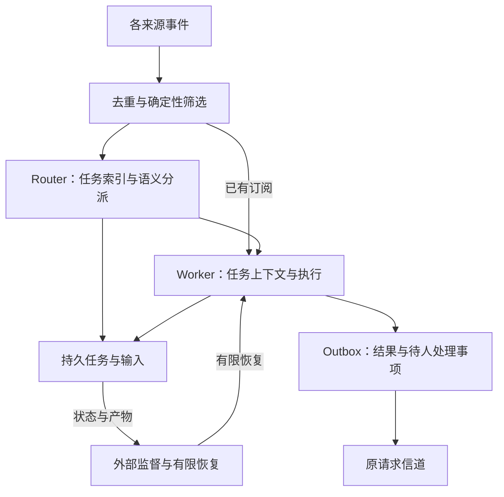

# 从会话工具到常驻协作者

简体中文 | [English](architecture.en.md)

核验日期：2026-11-01。本说明按 [官方技术文章](https://mp.weixin.qq.com/s/zoS7GlReWPhfCjENGxXCdg) 的主题组织，并与 DeepSeek 官方原型的领域、执行和架构资料交叉核对。工程建议和随附实验是本 Skill 的原创教学设计；是否已在公开原型实现，以 [原型对照](prototype-map.md) 的证据为准。

## 学习目标与双层分工

这项设计关注的瓶颈是人的注意力：模型会做更多事后，人仍需在多个任务间记进度、补上下文、找结果。协调层应接管这些任务管理工作，让人主要处理目标、决策和验收。这一目标可用于检验每个通知、表单和自动化动作是否有价值。[官方设计原则](https://github.com/deepseek-ai/dsh-superagent-prototype/blob/6337fc823ce20251c8de8085948165c81aaa701e/docs/000-philosophy.md)

图是设计层示意，不代表公开原型的完整调用图。Router 需要知道“哪个任务负责哪件事、当前需不需要人”；Worker 需要知道“当前任务的材料、执行结果和下一步”。不应让每条工具日志都进入 Router 的模型上下文。[官方架构入口](https://github.com/deepseek-ai/dsh-superagent-prototype/blob/6337fc823ce20251c8de8085948165c81aaa701e/docs/007-architecture.md)

## 五项设计如何变成工程决策

| 设计主题 | 要解决的问题 | 需要明确的决策 |
| --- | --- | --- |
| 双层架构 | 一个会话同时规划和执行，任务多后挤占上下文 | 全局索引保留什么、任务上下文如何隔离、并发如何计量 |
| 事件驱动 | 只等人反复下指令；后续消息导致重复任务 | 稳定事件键、订阅关系、新任务判断与后续输入归属 |
| 异步多信道 | 长命令阻塞交互，回复找不到原会话 | 持久输入、背压、取消、每个任务的回复目标和投递状态 |
| 存算分离 | Worker 或进程消失导致任务事实丢失 | 哪些状态持久化、恢复边界、执行代际与外部副作用去重 |
| 外部 Watchdog | 无人发现错误循环、停滞或基础设施故障 | 监督数据、活性/进展判断、重试预算、停止与升级条件 |

这些是评审问题，而非一组可以直接传给 Harness 的配置键。不要根据表格编造 `router.enabled`、`watchdog.autoFix` 等不存在的选项。

## 有限上下文中的按需召回

文章用 Inline & Spill 和 Chain of Recall 讨论上下文管理：把模型窗口视为有限缓存，近期相关对象适量内联，大正文放在窗口之外，以稳定对象 id 和下一跳引用逐步取回。不要只留下摘要而丢掉原始证据的读取入口，也不要为了“全局可见”把所有任务正文复制进 Router。公开原型的窗口限制、stub、按 id 展开与分页是可核实的具体机制；它们不是无限记忆的保证。[官方文章](https://mp.weixin.qq.com/s/zoS7GlReWPhfCjENGxXCdg)、[原型上下文组装](https://github.com/deepseek-ai/dsh-superagent-prototype/blob/6337fc823ce20251c8de8085948165c81aaa701e/docs/007-architecture.md)

## 事件路由与上下文

用稳定 id 记录来源和事件。先处理订阅的后续输入，再决定是否产生新工作；不要把“同一个 Thread”约束成“只能有一个任务”。遇到同一讨论中的独立需求，须有可解释的归属决策，而不是依赖最新会话碰巧在前台。

公开原型中，Trigger 是幂等单元，Ticket 是有授权的工作，Assignment 是具体执行的绑定。Subscription 传上下文，Correlation 补关联证据。领域术语和这些约束有专门定义，应沿用而不重新发明相似实体。[领域模型](https://github.com/deepseek-ai/dsh-superagent-prototype/blob/6337fc823ce20251c8de8085948165c81aaa701e/docs/001-domain.md)

确定性筛选处理来源、接收范围和身份等规则；语义判断处理“是不是一件要做的事、归哪个任务”。模型理解到需求，并不自动获得执行范围。后续消息属于输入，扩大工作范围仍需相应授权决策。[授权路径](https://github.com/deepseek-ai/dsh-superagent-prototype/blob/6337fc823ce20251c8de8085948165c81aaa701e/docs/002-authorization.md)

## 异步不只是开几个子代理

区分事件入口、Router、Worker、工具进程与回复投递。每条链路应有自己的排队和失败语义；让长命令转到后台只是其中一环，不能据此宣布任意工具都支持并发、取消和即时插入消息。

文章中的异步循环允许耗时工具先返回已启动，再把结果作为新事件加入会话，新消息在当前推理步结束后处理。它声称该机制在 Harness 中已实现但未默认开启；具体启用方式仍须查目标版本，不虚构一个通用开关。[官方原文](https://mp.weixin.qq.com/s/zoS7GlReWPhfCjENGxXCdg)

运行中的任务要定义新增输入何时被领取，任务结束后到达的消息怎样恢复或重新评估，以及移交给人时后台工作和并发槽位如何处理。公开原型的执行文档对此有具体约定，修改时应保留已有语义。[执行模型](https://github.com/deepseek-ai/dsh-superagent-prototype/blob/6337fc823ce20251c8de8085948165c81aaa701e/docs/003-execution.md)

## 持久化、恢复与交付

业务任务不应随一次执行实例结束。持久化任务、输入、有效 Assignment 和待交付结果；在事务中决定待做的副作用，再在提交后执行它。恢复时先识别已处理输入与当前执行代际，避免把旧 Worker 的迟到结果认作新完成。

Outbox 提供可恢复的发送尝试。若平台支持幂等键，使用稳定的消息标识；若不支持，必须承认“外部已发送、本地未记回执”的重复窗口。数据库事务不包住远端平台，测试应覆盖该窗口。[原型的 Engine / Outbox 边界](https://github.com/deepseek-ai/dsh-superagent-prototype/blob/6337fc823ce20251c8de8085948165c81aaa701e/docs/007-architecture.md)

## Watchdog 的监督边界

分别回答四件事：进程是否活着、任务是否推进、方向是否仍符合目标、是否有需要人的决定。它们需要不同证据，不能被一个健康布尔值替代。

为监督器提供任务目标、结构化状态、近期有效产物、错误和最后活动时间。对于“无进展”先区分等待外部条件、长耗时计算与重复失败。自动恢复应有次数/时间预算和停止条件；重派仍使用原任务范围。模型监督可以辅助判断，但不能因为换了一个模型就保证判断正确。

这部分是设计与验收建议。公开仓库中的 status、健康检查或运行脚本是否覆盖这些能力，必须逐项核对；存在健康页面不等于实现了自动语义纠偏。

## 可验收的故障场景

| 场景 | 应观察的结果 |
| --- | --- |
| 重投同一来源事件 | 没有第二份工作；记录或返回重复结果 |
| 两个任务交错收消息 | 输入按任务归属；任务 A 的私有执行材料不自动进入 B |
| 订阅收到 CI 或跟进消息 | 进入对应任务的上下文；不因每条更新新建任务或扩大范围 |
| 长任务期间有人追问 | 能持久接收并按既定时机继续，不丢输入、不假称立即执行 |
| Worker 超时后重新分派 | 输入仍在；旧 Assignment 无法提交覆盖新结果 |
| 进程重启 | 已持久事实可恢复；不假定内存、终端进程和外部副作用同时恢复 |
| 发送成功后回执丢失 | 识别可能重复的窗口，采用平台幂等或明确重复语义 |
| 普通进度和需要决策同时出现 | 普通进度记入任务，需要决策的信息送到合适的人和信道 |

优先以离线事件和模拟发送器验证，再按用户任务范围接入真实平台。将故障注入、业务逻辑与模型质量测评分开报告，不能用一个演示成功替代长期运行证据。
